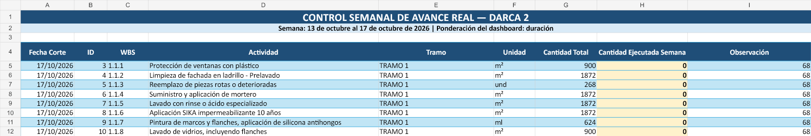
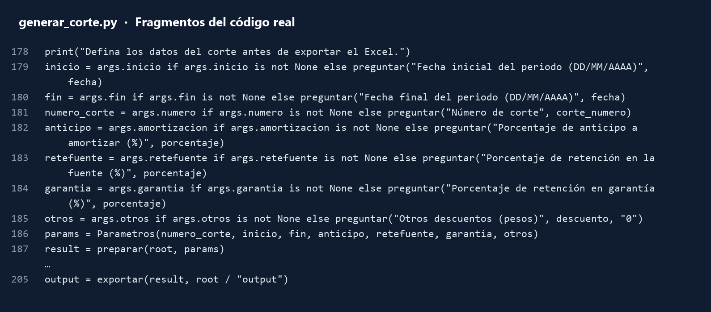
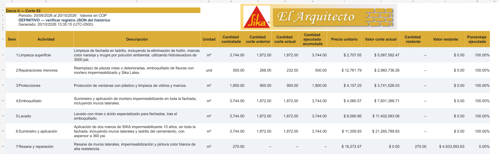

# Automatización de cortes de obra · DARCA II

Elaboré una herramienta en **Python** que me permite automatizar los cortes de obra a partir de los reportes de avance. El programa reúne las cantidades ejecutadas del periodo y genera el corte en Excel, con sus valores y el acumulado de la obra.

## 1. El punto de partida: los reportes

Cada semana registro la actividad, su código WBS, la unidad y la cantidad ejecutada. Estos reportes alimentan el programa.

*Vista de la hoja DATOS del reporte del 13 al 17 de octubre de 2026.*

## 2. La automatización

Antes de generar el corte, ingreso la **fecha inicial**, la **fecha final**, el **número de corte** y los porcentajes de anticipo y retenciones. Con esos datos, el programa procesa los reportes y exporta el resultado.

*Fragmentos reales de `generar_corte.py`: entrada de parámetros, preparación del corte y exportación a Excel.*

## 3. El resultado

Obtengo un Excel con las cantidades del periodo, las cantidades anteriores, el acumulado y los valores del corte. Así puedo revisar el resultado antes de confirmarlo.

*Vista del corte definitivo 2, del 20 de septiembre al 20 de octubre de 2026. Las imágenes de las hojas se generaron a partir de los Excel reales; muestran un extracto del contenido.*

**Herramientas:** Python · openpyxl · Excel.

[Ver también: dashboard de avance programado vs. real](https://github.com/loyal5889/dashboard-avance-programado-vs-real-curva-s)
