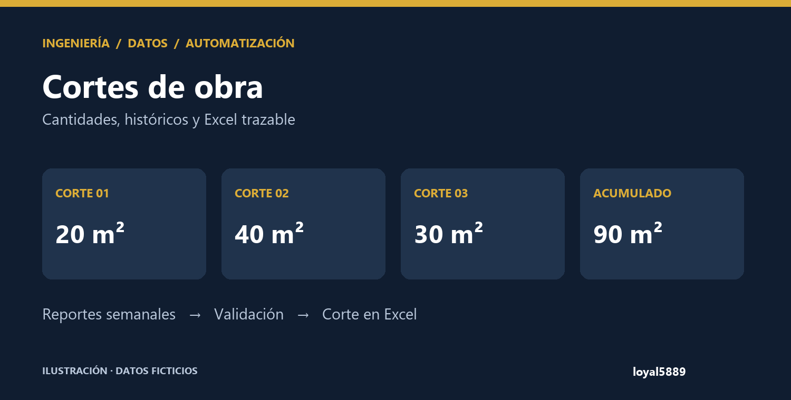
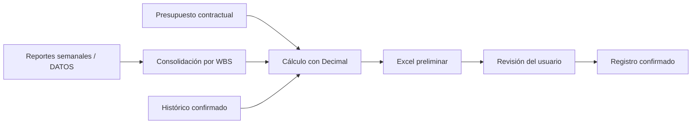

<p align="center"><strong>INGENIERÍA · AUTOMATIZACIÓN · CONTROL DE OBRA</strong></p>

# Automatización de cortes de obra

**De reportes semanales a un corte trazable en Excel.** Un programa en Python que conecta cantidades ejecutadas, presupuesto contractual e históricos para preparar cortes de obra con fórmulas auditables.



**Python · openpyxl · Decimal · Excel · JSON · unittest**

[Probar la demo](#pruébalo-con-datos-ficticios) · [Ver un Excel de ejemplo](examples/CORTE_DEMO.xlsx) · [Decisiones técnicas](docs/ARQUITECTURA.md) · [Proyecto complementario: Curva S](https://github.com/loyal5889/dashboard-avance-programado-vs-real-curva-s)

## El problema

Preparar un corte exige relacionar varios reportes con el presupuesto, descontar cantidades anteriores y aplicar deducciones. Hacerlo manualmente facilita errores como cobrar dos veces un avance o dejar fuera un tramo de la misma actividad.

## La solución

El programa identifica actividades por WBS, consolida reportes y calcula únicamente la ejecución correspondiente al periodo solicitado. Produce un libro con tres hojas: **Corte**, **Consolidado reportes** y **Presupuesto**.

| Función | Qué permite revisar |
|---|---|
| Una columna por corte confirmado | Cantidad individual de cada periodo, actual y acumulada |
| Vínculo WBS → ítem contractual | Varios tramos sumados dentro del mismo ítem |
| Precio, saldo y ejecución | Cantidades y valores conectados mediante fórmulas |
| Anticipo, retefuente y garantía | Porcentajes ingresados por el usuario y bases visibles |
| Histórico JSON con firma | Detección de cambios en registros y reportes ya utilizados |
| Borrador y confirmación separados | Revisar el Excel antes de registrar un corte |

## Pruébalo con datos ficticios

Requiere **Python 3.11 o posterior**. El conjunto de ejemplo se construye desde cero; no contiene información de una obra real.

```bash
git clone https://github.com/loyal5889/automatizacion-cortes-de-obra.git
cd automatizacion-cortes-de-obra
python -m pip install -r requirements.txt
python scripts/crear_demo.py
python generar_corte.py --numero 1 --inicio 2026-01-05 --fin 2026-01-17 --amortizacion 10 --retefuente 2 --garantia 10 --otros 0 --preliminar --confirmar-generacion
```

El resultado se guarda en `output/`. En Windows también puedes usar `INICIAR_CORTE.bat` para el flujo interactivo. Para consultar instrucciones: `python generar_corte.py --manual`.

El archivo [CORTE_DEMO.xlsx](examples/CORTE_DEMO.xlsx) muestra tres cortes ficticios. Por ejemplo, una actividad de 200 m² contratados tiene cantidades de **20, 40 y 30 m²**, para **90 m² acumulados**. Es un ejemplo técnico, no una cuenta de cobro.

## Flujo de información



## Mi trabajo en este proyecto

- Traducción del proceso de cortes a reglas verificables de cantidades, periodos y deducciones.
- Implementación de lectura de Excel, consolidación, generación de fórmulas y registro histórico.
- Resolución de casos reales de estructura: división por tramos e históricos por corte.
- Preparación de un flujo local con lanzador para Windows y pruebas de regresión.

## Validación

```bash
python -m unittest discover -s tests -v
```

La edición pública incluye pruebas con fuentes sintéticas para tres cortes consecutivos, retefuente, protección frente a sobrescritura del ejemplo y compatibilidad del desglose por tramos. El código contrasta los resultados del Excel con el cálculo de Python antes de entregar el archivo.

## Alcance y límites

- La estructura de las fuentes debe respetar los encabezados y la hoja `DATOS`. El mapeo se configura en `config/`.
- La regla de desglose de lavado incluida está acotada a tres tramos de 64 m²; no representa una conversión general automática para cualquier contrato.
- La retefuente se calcula como `(bruto − IVA sobre utilidad) × porcentaje`; es una regla del flujo implementado, no asesoría tributaria.
- El histórico exige confirmación explícita. Los borradores no se consideran cortes registrados.
- La edición pública omite presupuestos, fuentes e históricos originales. Los datos de muestra son ficticios.

**Autor:** [loyal5889](https://github.com/loyal5889) · [Explorar el dashboard de avance](https://github.com/loyal5889/dashboard-avance-programado-vs-real-curva-s)
